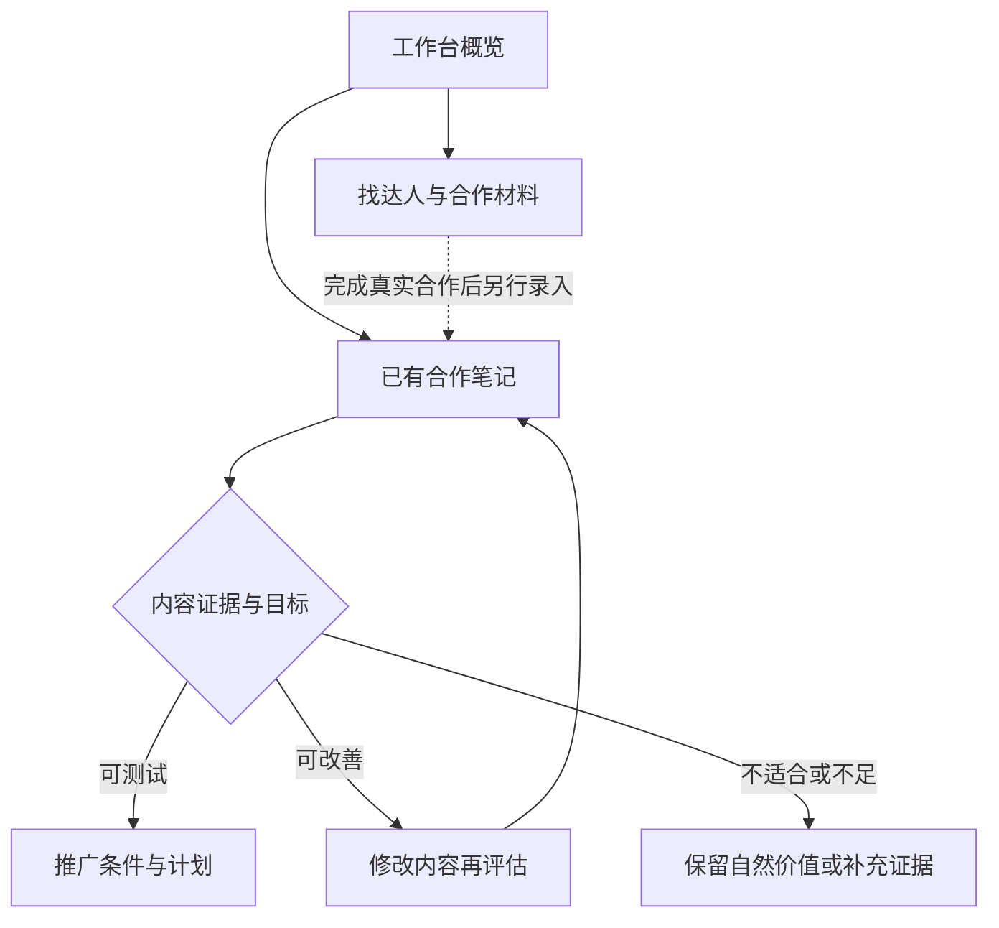

# 小红帽 V3｜产品设计说明

版本：2026-11-09，小红书场景精简版。用于 AI coding 作品说明。

## 1. 为什么做

目标用户是缺少达人筛选及内容投放经验的中小商家。产品问题假设是：商家难以把营销诉求转成选人条件，也难以把已有合作内容转成下一步经营决策。这些是待用户验证的问题假设，不是已经证明的普遍事实。

小红帽帮助商家从明确合作需求、选择达人，到判断合作笔记应优化、继续自然传播，还是进入小规模推广测试。品牌延续“您的一站式达人撮合伙伴”。中国、美妆、小红书、人民币是本期示例边界，并不宣称覆盖全行业。

核心假设：对已经拿到达人内容的 SMB，展示可追溯证据、缺失条件与具体行动，能够减少关键条件遗漏、提高决策理解与执行效率。当前没有真实用户实验或效果收益。

## 2. 为什么这样设计

- 工作台是 overview：项目、合作预算、已有内容、待办与下一步建议。摘要进入详情，不重复堆放所有指标。
- 找达人处理新合作：需求 → 推荐 → 名单和预算 → 独立邀约与 Brief。
- 合作内容是决策中心：图文、视频脚本 → 证据 → 规则 → 结论 → 行动。
- 推广准备承接行动：结构化预算、日期、指标、授权检查 → 可编辑计划 → 人工核对。没有真实广告创建或发送。
- 已有内容和新拟邀约名单分开。生成 Brief 不会自动生成“已完成合作”；空项目需明确点击载入模拟案例。
- 同一内容有两个状态：内容是否值得测试、准备条件是否齐备。缺授权不会自动被判为内容不好。

## 3. 用户流程

虚线是业务衔接，Demo 不自动执行真实合作；只提供显式载入模拟案例。

## 4. 合作用途与营销目标

用途为“达人账号发布 / 广告素材制作 / 发布与素材都要”；目标为“品牌曝光 / 新品认知 / 促进购买”。两者独立。素材导向合作降低对达人自身自然触达的依赖，先检查广告使用权；两种交付都要时核对综合报价。

权重为产品假设，所有维度分均为人工构造，不是平台数据、行业基准或已验证模型。

|用途与目标|自然触达|受众|内容|表达|互动|预算|
|---|---:|---:|---:|---:|---:|---:|
|账号发布·曝光|30|25|20|10|10|5|
|账号发布·新品|10|20|35|20|10|5|
|账号发布·购买|5|25|25|30|5|10|
|素材导向·曝光|0|15|30|40|5|10|
|素材导向·新品|0|15|35|35|5|10|
|素材导向·购买|0|15|30|40|0|15|

顺序：已知硬约束 → 条件待确认分组 → 目标评分。已确认不满足则排除；未知则保留在待确认组，不等同免费或已满足。受众仅用明确的示例标签。未知维度排除后归一化权重，另列已知证据覆盖权重；覆盖权重不是统计置信度。分数仅用于样例比较，不预测转化。

内容分 = 40%品类 + 30%内容重点覆盖 + 30%形式适配；用户未选形式或重点时对应子项取50%中性值并公开说明。预算分=(1−报价/预算)×100，下限0。搜索仅覆盖6个虚构案例。相似度采用标签交并比：品类35%、形式25%、内容重点25%、受众15%。

## 5. 白盒诊断

输入是预置的内容事实标注，不是实时多模态识别。三篇原创模拟内容中，两篇图文、一篇20秒视频脚本分镜。视频没有实际拍摄或播放分析。

决策顺序：
1. 项目归属、品类、人群与内容证据不足 → 暂不判断或不适配。
2. 品牌/产品信息缺失 → 曝光目标先补充品牌表达；新品与购买目标本轮不推广。
3. 开头、场景或与目标相符的行动说明缺失 → 先优化。
4. 上述内容条件满足 → 建议有限测试，仍不预测表现。
5. 独立检查授权、有效期、音乐权利，以及购买目标所需路径与衡量条件。

图文按封面、正文、图片顺序诊断；视频按开头、产品演示、结尾脚本诊断。证据按钮定位样张或脚本区间。高自然互动不直接触发测试建议；没有可比基准不声称高于行业。仅提供整体案例的有限事实，不声称已经核验所有功效或合规风险。

用户改变目标、内容条件、预算或授权后取消相关就绪状态；编辑正文保留并提示重新核对。可以在案例条件中模拟采用优化脚本、缺失证据、撤销授权等场景。

## 6. 预算与输出

新合作费、已有内容追加授权费、媒体测试预算、其他预留分开；总规划为四项之和。默认分别为6000、300、1200、500元，全为演示输入，不是行业均价。默认300元/3天测试草稿不等于平台门槛或足够的样本量。

新合作名单超预算不能生成材料；未知条件只支持询价草稿。多条已核对计划共同占用媒体及授权上限。计划确认需条件通过、查看本版诊断、勾选人工核对声明。输出包含状态、结构化预算和最后编辑正文，仍未创建广告。

中文邀约与 Brief 按达人隔离；复制、下载使用最后编辑。旧版保留英文材料及美国 TikTok 示例，新版不混用币种或达人数据。

## 7. AI、规则与商业价值

本期为 AI 辅助编程完成的规则 Demo。没有真实模型、平台 API、实时数据或邮件。未来 LLM 可以辅助需求结构化、证据摘要和文案；硬约束、金额、权限、版本和最终确认仍由确定性程序控制。

潜在商家价值是少遗漏条件、更快形成可执行判断；潜在平台价值是更多有准备的合作与测试。不能以广告素材使用率或消耗越高越好为目标，应同时观察无效投入和用户投诉。产品必须能建议不投放。

平台已有内容筛选和相关性预检，小红帽不宣称这些能力原创或官方集成。差异化假设是新手 SMB 能更容易理解和执行建议。

## 8. 验证方案与范围

先做5–8名目标用户的形成性任务测试，同一内容池比较普通列表与证据解释版：完成决策的时间、关键条件遗漏率、解释理由的准确性、修改建议可执行性。小样本用于发现问题，不宣称显著提升。后续有真实授权与广告实验条件再验证广告结果，明确对照、主指标和预算护栏。

已实现：单项目工作台、两类用途的排序、名单预算、中文材料、3篇模拟内容、4类内容结论、准备条件、可编辑计划与本地保存。

未实现：多项目管理、通用自然语言提取、真实小红书达人库、用户视频上传/理解、真实授权核验、发送、自动投放、归因、在线学习。真实有效性未验证。移动端为基本适配，不替代完整设备兼容测试。

## 9. 公开研究与边界

核查日期：2026-11-09。以下只支持机制设计，不支持本作品具体权重、价格或案例结论。

- [聚光：笔记抽屉笔记筛选功能说明](https://ad.xiaohongshu.com/next_help/docs/da701b07cc62d5a9ae9f3ea002f1f59d)：营销场景指标、数据权限与统计口径。文档更新日期2026-03-20。公开页面中的个别指标说明需以实际产品进一步核对，本作品不照搬存疑公式。
- [聚光：搜索工具与相关性预检](https://ad.xiaohongshu.com/next_help/docs/d6e54d83d20628f893180ec49b790cbd)：平台已有内容匹配、理由与优化建议。这里引用机制，不引用宣传收益数字。

未使用公司内部数据。小红帽为独立作品，不属于小红书或 TikTok 官方。
